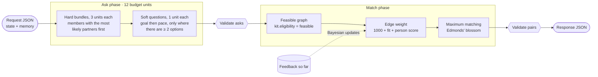

<div align="center">

# The Misfits · Sequential Reciprocal Matching

### Who to introduce, what to ask, and when, with a valid answer on every one of 14,400 calls

**Applied Machine Learning Programme & Hackathon** · Romeo & Juliet Ltd. × IIT Madras · Round 2 build, October 2026


-2ea44f)


-6f42c1)


**[Technical report](REPORT.md)** · **[Lab notebook](FINDINGS.md)** · **[Match-phase report](report/match.md)** · **[Round 1 proposal (BRVM)](docs/BRVM_round1_proposal.md)**

</div>

---

## Results at a glance

| | Expected MSMI / 100 vs greedy | 95% CI | Seeds (first use) |
|---|---|---|---|
| **Shipped policy · `full_person_learn`** | **+0.0115 (+3.0%)** | [+0.0044, +0.0186] | 341–380 × 6 families |
| ↳ gain from the Bayesian layer alone | +0.0041 | [+0.0012, +0.0071] | 341–380 |
| Simple core · `full` | +0.0092 (+2.4%) | [+0.0011, +0.0174] | 301–340 × 6 families |
| No clarification · `no_asks` | −0.2732 (−71%) | [−0.290, −0.257] | 301–340 |

- **Valid everywhere.** 0 invalid episodes across thousands of runs: the official subprocess protocol (18/18 on 101–103, 0.46 s per call) and the container.
- **Low-noise yardstick.** Comparisons use exact *expected* MSMI from paired worlds. It was validated against realised outcomes on 360 episodes and is about 10× less noisy than realised scores.
- **Honest ceiling.** A matcher that knew every true probability would gain only about +7% over greedy. We capture well over a third of that.
- **Fair waits.** Served shares are flat across responsiveness (33.7% / 34.3% / 33.6%), and the slowest group waits *less* than under greedy (p90 17 vs 20 days).

> All data and worlds are synthetic. None of these numbers describe real people.
>
> Realised MSMI scores (noisy at small episode counts) are reported in `FINDINGS.md` §12 and `results/final*.json` alongside expected values. On 240-episode confirmations, realised and expected differences are within one standard error of each other.

---

## How it decides, every simulated day



| Layer | What it does | Where |
|---|---|---|
| **Questions** | Hard-constraint bundles go to members with the most *likely* partners (unknown fields don't block), with +10 for arrivals in the last 3 days. Idle budget asks `relationship_goal`, then `relationship_pace`. | `misfits/asks.py` |
| **Allocation** | The **maximum number of pairs** each day. The weight `1000 + …` keeps cardinality first, so quality only breaks ties. | `misfits/match.py`, `misfits/blossom.py` |
| **Fit model** | Online Bayesian logistic regression on observed accept/reject answers. Its prior is our hand-set soft-field weights, so it adapts when outcome weights shift, without guessing the scenario. | `misfits/bayes.py` |
| **Person model** | Hierarchical empirical-Bayes Beta–Binomial for each member's responsiveness and acceptance. Shrinkage is averaged over prior strengths by marginal likelihood, and only resolved feedback counts. | `misfits/bayes.py` |
| **Safety shell** | Re-validates every ask and pair (eligibility, availability, repeats, budget, declined fields). Has a 3 s soft limit, a deadline-aware fallback, and memory checks for size and finiteness. | `policy.py` |

The policy reads **only the request JSON**. It never imports `analysis/`, simulator internals or hidden fields, and it contains no scenario-family-specific logic.

---

## What we learned

| Question | Answer | Evidence |
|---|---|---|
| Where is the value? | **Clarification.** No questions loses about 70%; selection headroom is only about +7%. | FINDINGS §3, §12 |
| What makes the matcher work? | **Using observed soft-field agreement.** Unit-weight maximum matching loses the whole gain (−0.0082). | REPORT §5.1 |
| Does waiting for a better match help? (Q1) | **No.** Simple reservation and our own sampled-future prices never beat λ = 0, even on dense graphs and unseen arrival mixtures. | REPORT §5.5 |
| Does it survive changing conditions? (Q2) | **Yes.** +0.0065 overall, +0.0123 when conditions switch mid-episode, with no family detection. | REPORT §6 |
| Do response penalties leave people waiting? (Q3b) | **No.** Shares stay flat, and the slowest group's p90 wait improves. | REPORT §6 |
| Are the models calibrated? | Monotone with positive Brier skill. The fit model gains +1.7% skill in the shifted-weights family. | REPORT §5.4 |

Known limitations — sparse geography, declined hard constraints, delayed feedback, and thin feasible graphs — are analysed in `REPORT.md` §7.

---

## Reproduce

> Run from the repository root. The policy needs no installs; the analysis tools use `numpy`.

```bash
# 1 · Kit checks, data integrity and our tests (36)
python -m unittest -v
python verify_data.py

# 2 · Official evaluator: our policy (DEFAULT_CONFIG) on the public seeds, real subprocess protocol
python evaluate.py --seeds 101,102,103 --variants all --output results/final.json

# 3 · The three supplied baselines on the same seeds and families
python evaluate.py --baseline no_asks --seeds 101,102,103 --variants all --output results/final_no_asks.json
python evaluate.py --baseline random  --seeds 101,102,103 --variants all --output results/final_random.json

# Linux / macOS
POLICY_VARIANT=greedy python evaluate.py --policy analysis/variant_policy.py --seeds 101,102,103 --variants all --output results/final_greedy.json
# Windows (PowerShell)
# $env:POLICY_VARIANT="greedy"; python evaluate.py --policy analysis/variant_policy.py --seeds 101,102,103 --variants all --output results/final_greedy.json

# 4 · Container (assessment mode)
docker build -t sequential-policy:submission .
python evaluate.py --image sequential-policy:submission --seeds 101 --variants all --output results/container_check.json
```

`--baseline greedy` (the evaluator's default) runs `DEFAULT_CONFIG`. The kit greedy baseline is reproduced through `analysis/variant_policy.py`, with actions identical to the kit's (`action_sha256` checked).

<details>
<summary><b>Analysis tools</b> (evaluation only; they read simulator truth and are never copied into the image)</summary>

```bash
python analysis/compare.py   --a greedy --b full_person_learn --seeds 201-230     # paired expected-MSMI comparison
python analysis/suite.py     --presets greedy,full,full_person_learn --refs full,greedy --worlds all --seeds 341-380 --output results/confirmation_341_380.json
python analysis/yardstick.py --preset greedy --seeds 201-260                      # expected vs realised validation
python analysis/headroom2.py --presets greedy,full --seeds 201-215 --output results/headroom2_201_215.json
python analysis/calibration.py --preset full --seeds 201-215 --output results/calibration_201_215.json
python analysis/q3b.py results/confirmation_341_380.json --presets greedy,full,full_person_learn --output results/q3b_waiting_341_380.json
```

World variants for Q1 and Q2 (dense graphs, sparse + delayed, a switch on day 30, mixed arrivals) are in `analysis/worlds.py`. They wrap `generate` and subclass `Simulator`; `kit.py` is never edited.

</details>

---

## Environment

| | |
|---|---|
| **Container** | `python:3.12.7-slim`, runs as `USER 65534:65534` (see `Dockerfile`) |
| **Local development** | Python 3.13.1 on Windows 11; any Python ≥ 3.10 works |
| **Runtime dependencies** | **None.** Standard library only; `requirements.txt` is intentionally empty |
| **Vendored code** | `misfits/blossom.py`: `max_weight_matching` from NetworkX 3.6.1 (BSD-3-Clause), verified identical on 6,000 random graphs |
| **Analysis-only** | `numpy` (`analysis/expected.py`), `networkx` (`analysis/analysis.py`, one optional test) |
| **Training / GPU** | None. No trained artefacts; every model is fitted online from the request |

## Declared seeds

| Purpose | Seeds |
|---|---|
| Development and all tuning (training seeds) | **201–260** |
| Confirmation of `full` and its ablations (first use) | **301–340** |
| Final confirmation of the Bayesian layer and the shipped default (first use) | **341–380** |
| Reproducing the published baseline numbers only | 101–103 |
| **Inference random seed** | **None.** The policy is fully deterministic and uses no random numbers (the kit's `random` baseline seeds `random.Random(17 + day)`) |

No seed group overlaps with another. Private assessment seeds are outside all of the above ranges.

<details>
<summary><b>Repository layout</b></summary>

```
policy.py               entry point + safety shell, presets, DEFAULT_CONFIG
misfits/
  asks.py               ask phase: question order and soft questions
  match.py              match phase: maximum pairs with tie-break terms
  bayes.py              observable-only Bayesian models (person, fit, slot prices)
  blossom.py            vendored maximum-weight matching (NetworkX, BSD-3)
tests/test_policy.py    fuzz and validity tests for the shell and every preset
analysis/               evaluation-only tools: expected MSMI, paired suites, worlds, calibration
results/                machine-readable results (force-added; results/ is git-ignored by the kit)
report/match.md         match-phase write-up (Siddharth)
REPORT.md               technical report: approach, experiments, limitations, calibration
FINDINGS.md             lab notebook: all numbered experiments and intermediate results
CHANGELOG.md            kit release history
docs/                   kit docs + our Round 1 proposal
kit.py, evaluate.py …   the organisers' kit at commit a8e26b3, unchanged
```

</details>

---

## Team

| | Role |
|---|---|
| **Krishna Vallabha Goswami** | Safety shell, expected-MSMI yardstick, tests, merges, confirmations, Q2, Bayesian layer, report |
| **Siddharth Malkania** | Maximum-pairs matcher and quality weights, Q1 reservation study, Q3b waiting analysis |
| **Rishi Mehrotra** | Question order and soft questions, Docker and container checks, Q3a |

## Licences and attribution

- Kit code and synthetic data: the organisers' terms in [LICENSE](LICENSE) and [DATA_LICENSE.md](DATA_LICENSE.md).
- `misfits/blossom.py`: NetworkX, BSD-3-Clause (notice reproduced in the file).
- **AI tools:** Claude Code (Anthropic) was used as a coding and analysis assistant throughout development. The team designed the approach, reviewed and ran everything, and owns all code, experiments and conclusions (see [REPORT.md](REPORT.md#provenance-licences-ai-tool-attribution)).

<div align="center">
<sub>Built for The Sequential Matching Problem · synthetic worlds only · no real people were matched in the making of this policy</sub>
</div>
